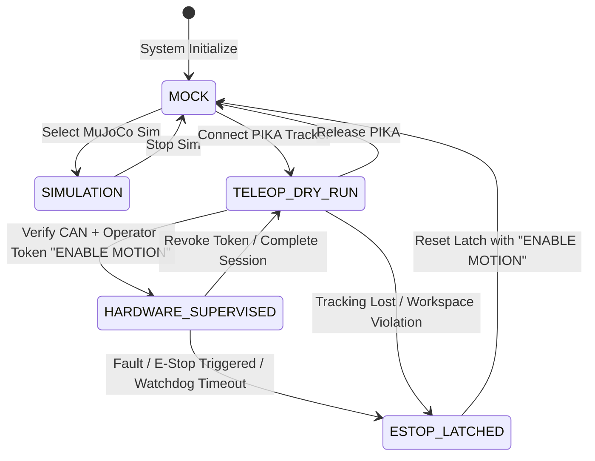

# JARVIS-PiPER Safety Case & Hazard Analysis

**Safety Standard:** ISO 10218-1 / ISO/TS 15066 Collaborative Robotics Safety Principles  
**Classification:** Level 2 Supervised Collaborative Manipulation  
**Response Latency:** $< 10\,\text{ms}$ software loop, immediate physical 24V bus cut-off  

---

## 1. Safety Objectives & Operational Boundaries

The primary objective of the JARVIS-PiPER safety system is to guarantee that **no physical damage to equipment, surrounding workspace, or operating personnel can occur during development, demonstration recording, or autonomous policy execution.**

### Operating Envelopes:
- **Maximum Safe Radius:** $600\,\text{mm}$ spherical envelope centered at arm base flange.
- **Cartesian Bounding Box:**
  - $x \in [0.100, 0.600]\,\text{m}$ (Forward reach)
  - $y \in [-0.450, +0.450]\,\text{m}$ (Lateral span)
  - $z \in [0.015, 0.550]\,\text{m}$ (Vertical clearance above table)
- **Hard Joint Position Limits:**
  - Joint 1 (Base Yaw): $[-2.618, +2.618]\,\text{rad}$ ($[-150^\circ, +150^\circ]$)
  - Joint 2 (Shoulder Pitch): $[0.000, +3.141]\,\text{rad}$ ($[0^\circ, +180^\circ]$)
  - Joint 3 (Elbow Pitch): $[-2.967, 0.000]\,\text{rad}$ ($[-170^\circ, 0^\circ]$)
  - Joint 4 (Forearm Roll): $[-1.745, +1.745]\,\text{rad}$ ($[-100^\circ, +100^\circ]$)
  - Joint 5 (Wrist Pitch): $[-1.222, +1.222]\,\text{rad}$ ($[-70^\circ, +70^\circ]$)
  - Joint 6 (Wrist Roll): $[-2.094, +2.094]\,\text{rad}$ ($[-120^\circ, +120^\circ]$)
  - Gripper Stroke: $[0.000, 0.035]\,\text{m}$ ($[0, 35]\,\text{mm}$)

---

## 2. Hazard Analysis & Mitigation Strategies

| Hazard ID | Failure Mode | Root Cause | Safety Interlock & Mitigation | Failure Behavior |
| :--- | :--- | :--- | :--- | :--- |
| **HAZ-01** | Unintended arm actuation on node start | Launch file defaults (`auto_enable=true`) | Single `SafetySupervisor` motion gate. Physical motion blocked unless operator provides `"ENABLE MOTION"`. | Reject command, arm stays in gravity compensation / limp state. |
| **HAZ-02** | Collision with table or workspace fixture | Policy prediction drift or IK anomaly | 3D Cartesian bounding box check ($z \ge 15\,\text{mm}$). Forward kinematics verification before motor packet assembly. | Clamp command to bounding envelope or halt with `WorkspaceViolationError`. |
| **HAZ-03** | Operator hand twitch / tracking jitter | Optical occlusion of PIKA Sense | 2nd-order Butterworth jitter filter (12 Hz cutoff) + tracking staleness check ($> 50\,\text{ms}$). | Immediate velocity zeroing, arm freezes in last valid pose. |
| **HAZ-04** | Communication loss between NUC and arm | USB-to-CAN unplugged or bus error | Command watchdog ($100\,\text{ms}$ timeout). SocketCAN error flag listener. | Latch E-Stop state, report `WatchdogTimeoutError`. |
| **HAZ-05** | High-speed runaway / excessive acceleration | Untrained neural network output | Velocity cap at $0.15\,\text{rad/s}$ during bring-up. Maximum position step clamped to $0.05\,\text{rad}$ per $20\,\text{Hz}$ tick. | Clamp position delta, count consecutive clamps, auto-halt if $> 15$ clamps. |
| **HAZ-06** | Gripper crushing target object or fingers | Command stroke exceedance | Gripper stroke bounded $[0, 35]\,\text{mm}$, grip effort threshold clamped to $\le 10\,\text{N}$. | Current feedback cut-off. |
| **HAZ-07** | Operator leaves workstation | Inattentive supervision | Continuous dead-man clutch requirement (PIKA Sense Button 1). | Releasing clutch immediately freezes robot arm. |

---

## 3. Emergency Stop (E-Stop) Hierarchy

1. **Tier 1 — Physical Hardware E-Stop:**
   - 24V DC inline industrial red mushroom switch positioned within reach of operator.
   - Physical breaker completely deprives arm servo bus of drive power.
2. **Tier 2 — Software Latch E-Stop:**
   - Triggered by `Spacebar` keypress, terminal command, or supervisor exception.
   - Sets internal `_estopped = True` latch.
   - Rejects 100% of incoming trajectory commands.
   - Requires explicit operator clearance with token `"ENABLE MOTION"`.

---

## 4. Operational Mode State Machine

---

## 5. Verification & Compliance Evidence
- 14/14 automated safety interlock tests pass (`tests/test_jarvis_release.py`).
- Fault injection tests verify that NaN, Inf, out-of-boundary, and stale commands are 100% rejected.
