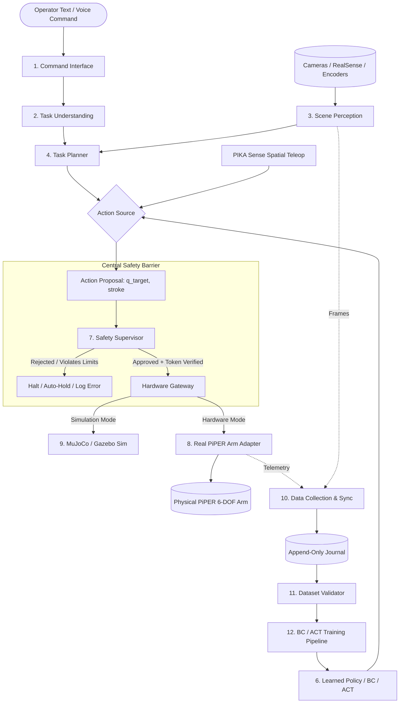

# JARVIS-PiPER System Architecture Specification (Phase 1)

**Status:** Approved Engineering Baseline  
**Version:** 1.1.0  
**Authors:** Senior Robotics Systems Integrator & Embodied AI Engineering Team  

---

## 1. Architectural Principles & Invariants

JARVIS-PiPER is structured around four strict non-negotiable architectural invariants:

1. **Fail-Closed Safety Monopoly:** No subsystem (teleoperation controller, natural language task planner, imitation learning policy, or simulation bridge) may directly actuate physical motors. Every action proposal must pass through the central `SafetySupervisor` before reaching a hardware adapter.
2. **Deterministic Mode Segregation:** The system operates in five mutually exclusive operating modes:
   - `MOCK` (Default, software-only verification)
   - `SIMULATION` (MuJoCo physics digital twin, hardware bus isolated)
   - `REPLAY` (Deterministic dataset playback, motors disabled)
   - `TELEOP_DRY_RUN` (Optical tracking & kinematics active, motor actuation disabled)
   - `HARDWARE_SUPERVISED` (Physical arm energized, requires operator token `ENABLE MOTION` and dead-man clutch)
3. **Decoupled Perception & Execution:** Perception generates observations with timestamped covariance and confidence. If tracking or camera latency exceeds $50\,\text{ms}$, the system falls back to a safe hold state.
4. **Reproducible Data Lineage:** All demonstration recordings are immutable, append-only, and validated against the 7-point quality standard before entering training pipelines.

---

## 2. High-Level Subsystem Flow

---

## 3. The 13 Core Architectural Subsystems

### 3.1 Command Interface (`jarvis.command_interface`)
- Provides unified CLI (`jarvis {doctor, teleop, record, validate, train, policy}`) and optional streaming text/speech interfaces.
- Converts raw strings into typed `UserCommand` structs.
- Supports offline text parsing without mandatory cloud API dependencies.

### 3.2 Task Understanding (`jarvis.task_understanding`)
- Resolves natural language commands into a structured `TaskSpecification`:
  - `task_type`: e.g., `PICK_AND_PLACE`, `INSPECT_SCENE`, `REPLAY_DEMO`.
  - `target_object`: e.g., `"red block"`.
  - `destination`: e.g., `"bowl"`, `"tray"`.
  - `confidence`: $[0.0, 1.0]$.
  - `ambiguity_detected`: Boolean flag triggering clarification requests.

### 3.3 Scene Perception (`jarvis.perception`)
- Ingests RGB-D streams from RealSense cameras (color: 1280x720 @ 30 Hz, aligned depth: 848x480 @ 30 Hz).
- Integrates local YOLO11 detector (`yolo11n.pt`) for bounding-box extraction.
- Computes 3D centroid coordinates in camera frame and projects into robot base coordinates using eye-to-hand calibration matrices.

### 3.4 Task Planner (`jarvis.task_planning`)
- Converts `TaskSpecification` and perceived 3D coordinates into a parameterized sequence of waypoints:
  1. `PRE_APPROACH` ($100\,\text{mm}$ above object)
  2. `APPROACH`
  3. `GRIP_CLOSE` ($0.035\,\text{m} \rightarrow 0.005\,\text{m}$, limited grip effort)
  4. `LIFT` ($80\,\text{mm}$ vertical clearance)
  5. `TRANSFER` (Interpolated joint path to destination)
  6. `LOWER`
  7. `RELEASE` ($0.035\,\text{m}$)
  8. `RETRACT` to nominal home pose.

### 3.5 Robot State & Sensor Interfaces (`jarvis.hardware`)
- Pure Python abstract interfaces (`ArmInterface`, `GripperInterface`, `TeleopInterface`, `CameraInterface`).
- Allows seamless switching between `Mock*` (with fault injection) and `Real*` hardware drivers.

### 3.6 Motion Planning & Learned Policies (`jarvis.learning`)
- **Baseline:** Multi-layer Perceptron Behavioral Cloning (`BCPolicy`) mapping $[\mathbf{q}, \text{stroke}, \mathbf{p}_{\text{target}}] \rightarrow [\mathbf{q}_{\text{cmd}}, \text{stroke}_{\text{cmd}}]$.
- **Advanced Track (Optional):** Action Chunking with Transformers (ACT) and V-JEPA visual feature encoders, isolated from core runtime.

### 3.7 Central Safety Supervisor (`jarvis.safety`)
- Single authority enforcing 10 concurrent safety interlocks:
  1. Hardware Motion Gate (`ENABLE MOTION` session token required for physical motors).
  2. Latched Emergency Stop (Software spacebar latch + hardware 24V line E-stop).
  3. Dead-Man Clutch (PIKA Sense Button 1 must be continuously depressed).
  4. Tracking-Loss Auto-Hold ($> 50\,\text{ms}$ tracking drop triggers immediate position lock).
  5. Command Watchdog ($> 100\,\text{ms}$ stream interruption halts motion).
  6. Verified Joint Angle Boundaries (PiPER S-V1.6-3 limits, Joint 3 strictly non-positive).
  7. Velocity Clamping ($\le 0.15\,\text{rad/s}$ during conservative bring-up).
  8. Cartesian Workspace Box ($x \in [0.10, 0.60], y \in [-0.45, 0.45], z \in [0.015, 0.55]\,\text{m}$).
  9. Anomaly Step-Jump Detection (Max joint delta $\le 0.05\,\text{rad}$ per tick).
  10. Strict Monotonic Time & Finite Value Gate (Zero NaNs/Infs).

### 3.8 Hardware Adapters (`jarvis.hardware.RealPiperArm`, `PikaSenseAdapter`)
- Interfaces directly with SocketCAN (`can0`) at 1,000,000 baud.
- Converts joint angle radians to raw CAN motor frames using manufacturer scale factors ($1000\,\text{deg} = \dots$).
- Reads 6-DOF optical packets from PIKA Sense via SteamVR USB dongle (`0x28de`).

### 3.9 Simulation Adapter (`jarvis.simulation`)
- Standalone MuJoCo digital twin (`assets/piper_mujoco.xml`).
- Fully isolated; zero CAN or hardware socket instantiation in `SIMULATION` mode.
- Enables deterministic offline evaluation and kinematic reachability checks.

### 3.10 Data Collection & Synchronization (`jarvis.record`)
- Asynchronous non-blocking streaming journal (`stream_journal.jsonl`).
- Atomic flush after every timestep ensures zero data loss upon abrupt termination.
- Monotonic microsecond clock ensures strictly increasing timestamps.

### 3.11 Dataset Validation & Exporters (`jarvis.dataset`)
- 7-point validation audit:
  1. File completeness (`metadata.json`, `stream_journal.jsonl`).
  2. Strictly monotonic timestamps ($t_{i} > t_{i-1}$).
  3. Finite observation array (no NaNs or Infs).
  4. Strict joint position compliance with physical limits.
  5. Bounded velocity profiles.
  6. Gripper stroke consistency ($0.0 \le s \le 0.035\,\text{m}$).
  7. Valid outcome label (`success` / `failed`).
- Exporters for Hugging Face LeRobot, ALOHA HDF5, and RLDS.

### 3.12 Training & Offline Evaluation (`jarvis.train`)
- Reproducible random seeds (`torch.manual_seed(42)`, `np.random.seed(42)`).
- Episode-level splitting prevents data leakage between consecutive frames.
- Offline baseline comparisons against Zero-Action and Mean-Action baselines.

### 3.13 Logging, Observability & Diagnostics (`jarvis.doctor`)
- Structured JSON logging of every safety rejection and mode transition.
- Comprehensive `JarvisDoctor` diagnostic CLI checking platform, Python, GPU, CAN, USB, and configuration health.
- Single-command bundle generator (`jarvis doctor --bundle`).
