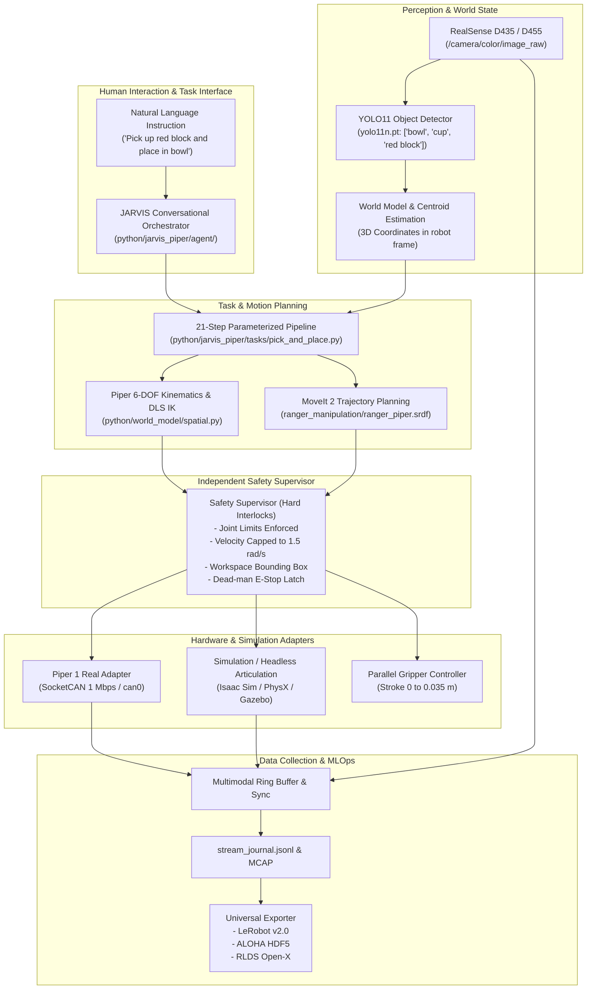

# JARVIS-PiPER: Software Dependency & Interface Map

**Architecture:** Layered Robotics & Embodied AI Architecture  
**ROS 2 Distributions:** ROS 2 Lyrical (WSL Ubuntu 26.04) & ROS 2 Humble (WSL Ubuntu 22.04)  
**Python Ecosystem:** Python 3.11.9 / 3.10.12 with PyTorch 2.x, ONNX Runtime, Ultralytics YOLO

---

## 1. System Architecture Map

---

## 2. Software Component Mapping

| Subsystem | Source Location | Dependencies | Primary ROS Topics / Services |
| :--- | :--- | :--- | :--- |
| **Agent / Orchestrator** | `python/jarvis_piper/agent/` | Regex, PyYAML | `/jarvis/instruction` |
| **Object Detection** | `Jarvis_Object_Detection.v1i.yolov11` | `ultralytics`, OpenCV, PyTorch | `/perception/detections` |
| **Spatial Kinematics** | `python/world_model/spatial.py` | NumPy, SciPy | Algorithmic FK/IK/Jacobian |
| **Safety Supervisor** | `python/jarvis_piper/safety/supervisor.py` | NumPy | State validation & E-stop |
| **Task Execution** | `python/jarvis_piper/tasks/pick_and_place.py` | Python 3.11 | High-level state machine |
| **MoveIt 2 Planning** | `ranger_manipulation/config/ranger_piper.srdf` | MoveIt 2, OMPL | `/piper_arm_controller/follow_joint_trajectory` |
| **Gripper Controller** | `ranger_control/config/controller.yaml` | ros2_control | `/piper_gripper_controller/follow_joint_trajectory` |
| **Data Exporter** | `python/dataset/exporters.py` | `h5py`, NumPy, OpenCV | LeRobot v2.0, ALOHA HDF5, RLDS |
| **Isaac Sim Articulation** | `scripts/isaac/` | Isaac Sim 4.x / Isaac Lab | `models/usd/piper.usda` |

---

## 3. Python Package Environment

The following key packages are verified and available:
- `torch>=2.1.0` (with CUDA support on RTX 5060)
- `onnx>=1.23.2` & `onnxruntime>=1.31.0`
- `opencv-python>=4.8.0`
- `numpy>=1.22.0`
- `pytest>=8.0.0`
- `h5py>=3.8.0`
- `pyyaml>=6.0`
